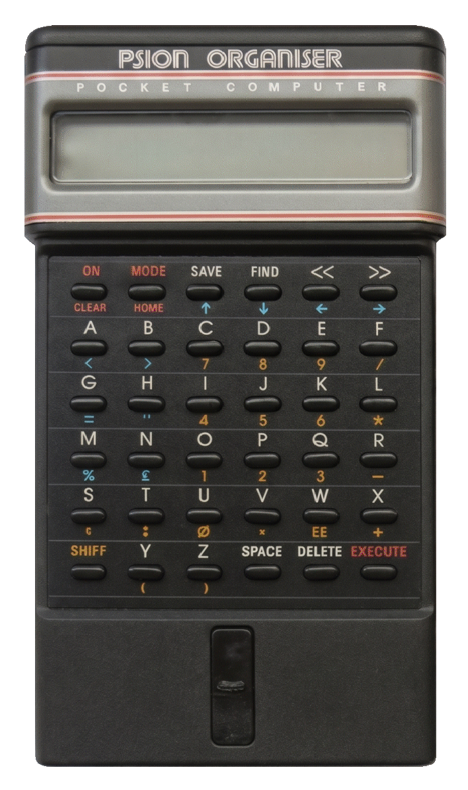

# SIMORG1

A modern, web-based simulator for the Psion Organiser I devices  
This web application simulates the device. It is a stand-alone, CDN less (no dependencies) and requires no internet connection to operate where hosted locally. With Drag and Drop support for .OP1 format data packs and serial port support (using the browser's Web Serial API).

This repository is intended to be accessed at https://nofitnessforpurpose.github.io/WebTools/simorg1/index.html  

 

  

  
  

 

 

## Features  
- **Cycle-Accurate Hitachi HD6301 Emulation**: Mode 6 multiplexed bus clocked at 921.6 kHz, 192-byte internal zero-page RAM (`$0040–$00FF`), 2K external static RAM (`$4000–$47FF`), and simulated 'On Chip' ROM (`$F000–$FFFF`).  
- **1×16 Dot-Matrix STN LCD**: Authentic 5×8 character generator font, 2-line split DDRAM addressing (`$00–$07` and `$40–$47`), full 64-byte CGRAM User Defined Graphics (UDG), adjustable contrast (`0–10`), pixel spacing, and optional smooth scaling.  
- **Dual Linear Data pack Bays (Slot 1 & Slot 2)**:  
  - Format blank **8K**, **16K**, or **32K** EPROM Data packs in-browser.  
  - Drag-and-drop or upload `.op1` or `.bin` Data pack images, and download modified packs back to disk.  
  - Bundled **Link-Up Hardware Adapter Simulator (`packs/connector-pack.op1`, ID `$02`)** for RS-232 / Web Serial support.  
- **RS-232 Comms Link (Web Serial)**: Connect a physical serial port via the browser Web Serial API when a `$02` Connector Pack is inserted.  
- **Machine State Snapshots**: Save and restore full state.  
- **Piezo Buzzer & Tactile Audio**: Web Audio API synthesiser for authentic Organiser I buzzer tones and key-click feedback.  
- **Photorealistic Interactive Chassis**: 7-layer responsive device frame with a draggable sliding protective cover and floating bottom-right controls drawer.  
- **Export Capabilities**: Download data packs.  

 

### PC Keyboard Shortcuts

| PC Key | Organiser 1 Key | Function |
| :--- | :--- | :--- |
| `Escape` | **ON/CLEAR** | Power on, clear line, recover clock |
| `F1` or `M` | **MODE** | Cycle menu items (`ENTER:`, `OFF:`, `CALC:`) |
| `F2` | **SAVE** | Select SAVE activity |
| `F3` | **FIND** | Select FIND activity |
| `Enter` | **EXE** | Execute activity / compute |
| `Backspace` | **DEL** | Delete character |
| `Space` | **SPACE** | Insert space |
| `←` / `→` | **<< / >>** | Scroll cursor / move window |
| `Shift` | **SHIFT** | Toggle numeric / symbol mode (NUM) |
| `A` – `Z` | **A – Z** | Type letters |
| `0` – `9` | **Shift + Key** | Type numbers |
| `+`, `-`, `*`, `/` | **Shift + Key** | Math operators |

# Data pack Loading & Software Packs

The release distribution ships with the **Link-Up Hardware Adapter** (`packs/connector-pack.op1`, ID `$02`).

To load software or data packs:
- **Upload / Drag-and-Drop**: Open the **Data packs** tab in the controls drawer (bottom-right menu button or double-tap the sliding cover) to upload `.op1`, or `.bin` files, or drag files directly onto Slot 1 / Slot 2 on the device.
- **Format Blank Packs**: Create blank 8K, 16K, or 32K packs directly in Slot 1 or Slot 2 and download them as `.op1` files.
- **Optional Self-Hosting**: If you host your own pack images under `packs/` matching the drop down filenames, selecting them from the Slot 1 / Slot 2 drop downs will fetch them automatically at runtime.

### Hints 
  - Create new packs using the menu feature
  - If using serial port features ensure your web browser supports WEB Serial (Firefox 151 does now!!!!)
    
   

## Background  

Downloading developed packs to the classic device was not supported. This tool allows testing prior to committing to a data pack

As the project uses Web Serial, you can connect a huge range of devices such as RP2040, RP2350's, Raspberyy PI's, Arduino, PC, ESP32 etc. as these all have serial support. Where your hardware does not, it's trivial to implement bit banged support.  

 

## Technical Details

*   **Architecture**: Built in 100% pure vanilla JavaScript with zero external dependencies, libraries, or CDNs.

 

## NOTE - BETA Software 

*   Implemented by **Antigravity**
*   Imagined by NFfP

 

## Questions / Discussion
See <a target="_blank" rel="noopener noreferrer" href="https://www.organiser2.com/"> Organiser 2 </a> forum, though see note below first.

 

## Please note:  
All information is For Indication only.
No association, affiliation, recommendation, suitability, fitness for purpose should be assumed or is implied.
Registered trademarks are owned by their respective registrants.

